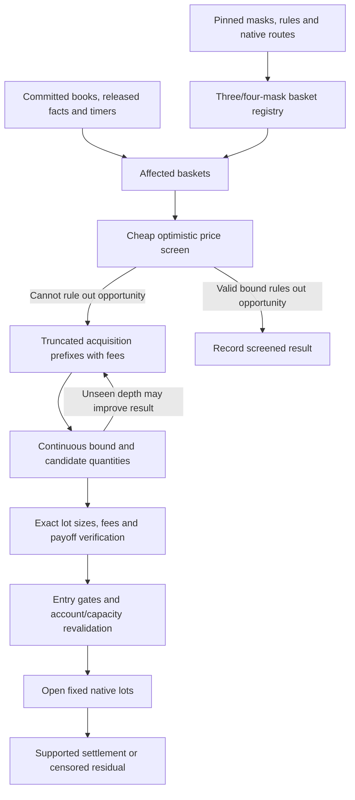

# Bounded payout optimizer: masks, triggers and acquisition curves

Status: **PROPOSED — discussion record and pipeline overlay; no implementation.**

Written 2026-10-11 against `codex/payoff-optimizer` at
`f77a5cf1fe7f339e4a0202d6b3d6568c417416e9`. The implementation inspected for
this note is on that separate branch; this authoring worktree contains the
shared specifications but does not contain the optimizer package yet.

This proposal narrows and changes the search policy in
[the V1 optimizer specification](BOUNDED_PAYOUT_OPTIMIZER_V1.md). It does not
supersede that specification or describe already shipped behavior. Accounting,
visibility, capacity and settlement continue to follow
[the economic position scenario contract](ECONOMIC_POSITION_SCENARIOS_V1.md).

## 1. Changes discussed

Build candidate baskets from **distinct payoff masks**, then retain native books
as acquisition routes for those masks. Focus this policy on baskets with **three
or four distinct masks**. Remove the ordinary two-mask plays already covered by
the existing strategies, and explicitly identify any additional basket families
whose full economic domain those strategies already evaluate.

Maintain a cheap price screen for each basket. A relevant book update should
first refresh that screen; detailed quantity sizing begins only when the screen
cannot rule out a qualifying purchase. Build cumulative acquisition curves only
for surviving baskets, and extend them only as far as economically justified.

Include the applicable pinned fees in acquisition costs. Cache repeated fee
calculations and cumulative prefixes. Use a continuous optimization relaxation
to find promising sizes and bound unexamined quantities; refine and verify the
actual lot-sized, rounded-fee positions exactly.

The objective remains **maximum minimum net profit**, after fees and declared
holding charges, rather than maximum payout, contract count or return percentage.

## 2. Overlay on the current pipeline

All implementation names in this table refer to the inspected optimizer branch.

| Stage | Current behavior | Proposed change and where it fits |
| --- | --- | --- |
| Prepare and validate inputs | Pin membership, exhaustive outcome spaces, native economics, rules, quantities, fees, game policy and account configuration. | Add an explicit candidate policy for distinct-mask counts and excluded basket families. Pin its identity. Preserve existing admission requirements. |
| Stage observable state | `Runtime.__call__`, `release`, `flush` and `decide` commit same-time books, scope changes, released facts and timers. | Preserve this ordering. Add basket dependency tracking after the committed state is available. Lifecycle timers still run even when no acquisition basket needs sizing. |
| Build native models | `scenario.models` constructs a model for each eligible native book, with its mask, source, scales, grid, cap and rule binding. | Separate structural mask groups from native routing models. Compile basket geometry on structural changes, rather than reconstructing native-book support combinations on every price update. |
| Select baskets | `core.solve` seeds covers and enumerates supports from one through `max_legs` native books, subject to the configured limit. | Generate only declared three/four-mask baskets. Check outcome coverage and the explicit existing-strategy exclusion registry before book-depth work. Count logical masks separately from native orders. |
| Decide whether to size | The current whole-input fingerprint skips identical acquisition states. Other relevant changes can start quantity search; there is no maintained per-basket price gate. | Recheck only affected baskets using best-price optimistic bounds. Defer curve construction and detailed sizing while a basket is ruled out. |
| Acquire prices and fees | `scenario.price_order` walks a requested quantity and assesses one ordered fill per consumed native level. A bounded cache already stores pinned whole-order economic amounts. | Build bounded cumulative prefixes once, including fees. Cache schedule/price/quantity fee primitives separately from source-dependent curves. Query earlier full levels from the prefix and price only the final partial level. |
| Optimize quantities | `core.solve` enumerates quantity grids with gross branch bounds; `PortfolioEvaluator` scores compiled mask arithmetic. | Solve a segment-based continuous relaxation, expand relevant curve prefixes and use its bounds to guide exact discrete refinement. Avoid the full quantity cross-product where a valid bound eliminates it. |
| Verify and qualify | Retained candidates receive fresh fee proofs. Exact margin and return gates determine qualifying findings. | Preserve that boundary. Verify native quantities, actual fees, retained payouts, valuation, holding charges and joint source use before treating a candidate as positive. |
| Revalidate and open | Detection uses undepleted books. Immediate entry re-solves against account cash and cumulative capacity; delayed entry freezes native support and maximum quantities. | Reuse the same curve/solver machinery on the entry domain. Detection curves do not authorize entry against depleted books. Preserve delay restrictions and all-or-none posting. |
| Hold and settle | Fixed acquired lots remain until supported resolution; unresolved run-end holdings are censored. | Preserve this behavior. Curve cutoffs and later signal loss affect new acquisitions, not held lots. |
| Write and independently read | Version-2 output carries economic proofs and lifecycle evidence. `audit.py` and `output.py` independently reprice and reconstruct them. | Add versioned candidate, screening, curve-bound and solver evidence. The reader must independently validate exclusions, carried bounds and exact portfolios without importing the writer's optimizer. |



## 3. Masks are economic legs; books are native routes

An outcome space is the set of possible normal-resolution outcomes. A payoff
mask is the subset on which a claim pays. Sharing an outcome space does not
make A-wins and B-wins the same mask.

Aligned A-wins claims on Polymarket and Kalshi have the same payoff mask under
the reviewed rule assumptions. They remain separate native routes with their
own fees, lots, cash balances, depth and source identities. Mask equality alone
does not establish matching cancellation rules or USD/USDC convertibility.

Split acquisition is **already possible** in the current optimizer: separate
native variables with the same mask can both receive positive quantities. The
change is to organize and size those routes under one logical leg, rather than
counting venue alternatives as different basket masks. Three masks can therefore
require more than three native orders.

Use separate limits for distinct masks and native acquired orders. Do not silently
reinterpret V1's `max_legs`, which currently counts native acquired claims.
Preserve native quantity grids, cash budgets and aggregate physical source
consumption after grouping. A pooled curve must retain its route decomposition;
it cannot treat cash on different venues as freely interchangeable.

Compile groups separately for the static full-space and released-state-conditioned
problems. Retain original full-space masks and rule identities for traceability.
Supported released results can change conditional equivalences and basket
coverage. A map-end or phase transition without a winner does not shrink the
space. Acquired positions retain their original native identities and quantities.

## 4. Candidate construction and existing-strategy exclusions

Generate sorted, canonical sets of three/four distinct masks within one compatible
exhaustive outcome space. For long-only claims with nonnegative costs, a basket
that leaves a feasible outcome entirely uncovered cannot have positive minimum
profit. Reject that structure before sizing. Coverage alone does not prove profit.

Duplicate native listings do not multiply the number of structural baskets.
For illustration, 12 native books representing six distinct masks have at most
35 three/four-mask subsets before coverage and policy filters: 20 triples and
15 quadruples. This is a combinatorial upper bound, not a measured viable count.

Record exclusions explicitly. The three/four-mask policy intentionally excludes
V1's one-leg known-payout and two-mask candidates; exclusion is not evidence that
those trades have no economic opportunity.

For additional existing-strategy exclusions, identify the exact family and its
supported routing, quantity, rule and fee domain. A same-venue complete-set
implementation does not automatically establish coverage of all cross-venue
versions or unequal-quantity variants. The precise registry remains to be pinned.

**Do not discard a larger basket merely because a subset is a known cover.**
For example, on outcomes A-2-0 / A-2-1 / B-wins, these three masks pay:

| Mask | A-2-0 | A-2-1 | B-wins |
| --- | ---: | ---: | ---: |
| A-series win | 1 | 1 | 0 |
| NO A-2-0 | 0 | 1 | 1 |
| NO A-2-1 | 1 | 0 | 1 |

At .60 each, every equal-sized pair costs 1.20 per unit against a minimum
payout of 1. All three cost 1.80 against a minimum payout of 2. Excluding every
superset of an existing pair family would remove this useful overlap basket.

## 5. Cheap price triggers and dependencies

The trigger has two boundaries: a cheap **sizing trigger** and the existing exact
**entry predicate**. Passing the cheap screen means further work is justified;
it is not a positive signal or authorization to take a position.

For a declared fixed ratio r, let L(r) be its minimum unit payout. Before fees,
an additional basket unit improves profit while:

```text
sum_i r_i * marginal_price_i < L(r)
```

For the equal-sized overlap above, this becomes `p1 + p2 + p3 < 2`.
With fees, use applicable effective acquisition prices and holding charges.
Testing only one ratio cannot rule out all unequal-quantity opportunities.

For free quantities, use a small optimistic relaxation: permit available routes
to acquire up to their caps at their best current prices, with a supported lower
bound on fees. Ignoring additional constraints is allowed for an upper bound;
inventing cheaper prices or fee applicability is not. A certified nonpositive
upper bound can screen out the declared basket. A bound below an entry threshold
can screen out entry eligibility without labelling all profit nonpositive.

The dependency index maps native acquisition sources to their basket users.
Price, relevant depth, usability, scope and supported knowledge changes invalidate
the affected screens, prefixes or solutions. A cheaper alternative venue must
also invalidate a basket whose previously selected route did not change.
Changes beyond a retained prefix may be ignored for sizing only if the existing
tail certificate still covers the updated state.

These subscriptions are strategy work selection. Capture and replay continue
preserving the input evidence. Pending entries, held-lot settlement, liquidation
marks and required quiet timers retain their own dependencies.

## 6. Cutoff prices and lazy curve construction

For a fixed ratio, the gross marginal cutoff for book i is:

```text
p_i,max = (L(r) - sum_{j != i} r_j * p_j) / r_i
```

For `r = (1,1,1)`, `L = 2` and the other two prices .60, the cutoff is .80.
Cheapest prices on the other legs give an optimistic cutoff. Their increasing
prices and applicable fees tighten it. With price-dependent cash fees, compare
the marginal all-in cost with the remaining payout allowance, rather than
subtracting one constant fee from every raw price.

This is a cutoff for additional profit along that ratio. It does not mean the
already accumulated basket becomes negative after the next marginal unit loses
money. It also does not establish a universal cutoff for independently varying
quantities, rounded fees or every route allocation.

For unrestricted quantities within the declared baskets:

1. Build short best-first prefixes, only at occupied book levels.
2. Model an unseen tail optimistically at its next available price, with remaining
   configured quantity cap as an upper bound on depth. Use a fee lower bound and
   relax any unresolved native constraints when necessary to preserve optimism.
3. Solve that relaxation to bound what deeper real acquisition could achieve.
4. Expand the routes used by a potentially improving optimistic tail.
5. Stop when a verified bound rules out improvement, or a declared work limit is
   reached. A work-limit stop preserves the remaining uncertainty.

Later raw asks cannot be cheaper in a best-first ladder. The corresponding
fee/retained-payout bound must also cover the unseen prices; do not assume an
arbitrary fee-adjusted curve is monotone. If that property is not established,
use a looser valid envelope or expand more depth.

Keep prefix quantity, gross cost, fee-adjusted cash cost, retained quantity,
native route and physical source use. A curve query uses the complete preceding
levels plus an exact partial final level. For example, 100 contracts at .60 plus
20 at .62 cost 72.40 before fees, not `120 * .62`.

## 7. Fees inside the curves

For the Fee SDK's supported ordinary cash-fee models, the unrounded formulas are:

```text
Kalshi:     F(q,p) = q * .07 * multiplier * p * (1-p)
Polymarket: F(q,p) = q * rate * [p*(1-p)]^exponent
```

At a fixed occupied price, these are linear in quantity. The unrounded segment
cost is `q * (p + fee_per_contract(p))`. Resolve and pin the applicable schedule;
there is no universal venue-wide rate fallback.

Precompute or lazily memoize exact rounded costs for the declared quantity grid.
Keys must cover the resolved model, policy, side, price, quantity, native fee
asset/scales and any relevant rounding state. Equal numeric models may share
economic primitives across books; native bindings and fresh assessment identities
are retained separately. Source-dependent prefix costs additionally depend on
the eligible ladder and account capacity.

Preserve one declared order per acquired native claim per action, with one
ordered fill per consumed level. Aggregating different price levels into one average-price fill
changes both the nonlinear price formula and rounding. Multiplying a rounded
one-contract fee by 100 is not the same as assessing a declared 100-contract fill.
The current optimizer excludes account rebates and rounding refunds; preserve
that policy unless a separately specified change introduces stateful accounting.

Synthetic example, .62 asks, ordinary Kalshi taker multiplier 1, non-direct
membership and a single declared fill:

| Quantity | Gross acquisition | Unrounded fee | SDK cash cost including rounding |
| --- | ---: | ---: | ---: |
| 100 | 62.00 | 1.6492 | 63.65 |
| 1,000 | 620.00 | 16.492 | 636.50 |

These amounts are reusable under the same inputs. They are not historical
execution-fee observations. The current SDK's evidence and partition assumptions
remain on all final proofs.

A pointwise maximum of the applicable venue fee curves, in the declared common
valuation basis, is an optional conservative cost model. Positive profit under
that higher cost survives lower supported modeled fees. Its negative result can
hide actual-fee positives: **do not use it as an upper-profit bound to certify a
negative or prune the actual-fee optimum**. Recommended default: optimize using
each native route's actual pinned model, with valid optimistic bounds for pruning.

Any supported outcome-token fee reduces retained payout quantity. It cannot be
represented merely by adding its execution-price value to cash acquisition cost.
Keep a retained-quantity function alongside cash cost for those routes.

## 8. Joint sizing, discrete refinement and certificates

For the three overlap masks, let C_i(q_i) be cumulative cash acquisition cost.
With unit retained payouts, the continuous objective is:

```text
maximize min(q1+q2, q1+q3, q2+q3) - C1(q1) - C2(q2) - C3(q3)
```

Increasing ordered all-in marginal prices make each C_i convex; the minimum of
linear payouts is concave. Representing occupied levels as quantity variables
with constant unrounded unit costs gives a linear-program formulation. For one
valuation scenario, introduce minimum-net-margin variable m:

```text
maximize m
subject to, for every feasible outcome w:
    m <= sum_native_levels payoff(w, level)
         - sum_native_levels acquisition_cost(level)
         - holding_charge_bound
```

Add depth/cap and supported native constraints. Multiple pinned valuation
scenarios add a margin constraint for every outcome/scenario pair. Native routes
remain separate variables even when they share a payoff mask. Physical aliases
share one resource; scalar valuation never enables native cash transfers.

The relaxation guides quantities and provides valid upper bounds. Actual positions
must satisfy lot grids, positive quantity in three/four distinct masks, the native
order limit, exact rounded fees, native cash and cumulative source capacity.
Those restrictions may require integer search or a mixed-integer formulation.
Precomputing rounded costs makes evaluation cheaper but does not make the exact
discrete problem continuous or automatically convex.

Use bounded exact refinement around promising candidates **and over any remaining
domain not eliminated by a valid bound**. Only checking nearby rounded versions
can find a feasible positive; it cannot certify the discrete maximum or a negative.
When using a numerical solver, proposals and floating-point statuses are not
economic proofs. Recheck feasible candidates and any claimed upper-bound
certificate with exact arithmetic at the independent verification boundary.

Preserve objective tie-breaking by lower cash commitment, fewer native orders
and deterministic native quantity keys. An attained objective bound can establish
maximum margin while leaving the tie domain unresolved; report that distinction.

Keep one shared whole-decision work budget across static/conditioned detection,
prefix expansion, refinement and immediate/delayed entry work. Solver iterations,
curve levels, cache memory and proof size also need explicit limits: counting
one solver call as one old search node would not bound its internal work.

## 9. Signals, positions and audit evidence

Exact entry continues to require all admission and accounting conditions plus:

```text
M > 0
M >= minimum_net_margin
10000 * M >= minimum_return_bps * acquisition_cash_value
```

The price screen and curve cutoff never replace these gates. Account revalidation
may change the feasible size or routes within the permitted immediate-entry
domain. Delayed entry retains the existing frozen native support and quantity
caps; it cannot silently switch to a newly cheap venue.

Retain fixed acquired lots until the configured supported settlement. New game
facts can update their conditional payout reporting without resizing them or
creating cash. Scope changes cancel affected pending entries and preserve held
claims and original source debits.

Outputs should distinguish structural exclusion, missing input, certified screen,
entry-threshold screen, feasible positive, unclosed optimization gap and work-limit
stop. These are different reasons and measurable-time categories. Negatives and
optimality claims must name their declared basket/route/quantity domain and the
certificate that covers it. A narrowed three/four-mask result is not a result for
V1's former broad domain.

Include candidate identity, mask-to-route mapping, exclusion reason, screen
inputs/bound, prefix boundaries, tail assumptions, actual/conservative fee model,
exact native orders, remaining bound/gap and work counters. Reuse bounded
checkpoint/delta transport rather than repeating entire curves in every row.
Any new closed fields or policy semantics require explicit versioning and matched
writer, independent reader and fixtures.

The independent reader must rederive the relevant mask geometry, native fee/payoff
amounts, capacity/cash conservation, lifecycle and carried certificates. It must
not accept the writer's solver output as proof of an omitted opportunity. Without
independent coverage evidence, preserve the current writer-attestation limitation.

## 10. Implementation sequence and decisions still to pin

Suggested sequence:

1. Define versioned mask-count/native-order policy and the exact exclusion registry.
2. Compile mask baskets, native alternatives and dependency indices.
3. Add a certified cheap screen and explicit screened-result accounting.
4. Add bounded curve prefixes, fee primitive caching and exact partial-level queries.
5. Add the relaxation, tail expansion and bounded discrete refinement.
6. Integrate both detection and account revalidation, then extend the independent
   reader and output versions with coverage/bound evidence.

Still to pin before implementation: the exact additional excluded families;
native-order cap when venue splitting increases order count; solver backend and
exact certificate format; work/curve/memory limits; and whether a conservative
fee-envelope scenario is wanted alongside the recommended actual-fee scenario.
No arbitrary percentage defining "near the trigger" was agreed; the proposed
optimistic price screen supplies the economic trigger instead.

Later verification should cover duplicate-mask routing and native cash separation,
the overlap example despite existing pair covers, unequal sizes, rounded fees,
partial-level prefix queries, a cheaper alternate venue, tail-bound invalidation,
game/scope changes, delayed frozen support and independent certificate corruption.
Profile the same retained synthetic fixtures before and after; no speedup or
real-event completion estimate is established by this design note.

Baseline source references:

- [Observer-time runtime](https://github.com/hridyansh07/prediction-indexer/blob/f77a5cf1fe7f339e4a0202d6b3d6568c417416e9/replay/strategies/bounded_payout_optimizer/strategy.py)
- [Native models, pricing and search coordinator](https://github.com/hridyansh07/prediction-indexer/blob/f77a5cf1fe7f339e4a0202d6b3d6568c417416e9/replay/strategies/bounded_payout_optimizer/scenario.py)
- [Current discrete search](https://github.com/hridyansh07/prediction-indexer/blob/f77a5cf1fe7f339e4a0202d6b3d6568c417416e9/replay/strategies/bounded_payout_optimizer/core.py)
- [Independent reader](https://github.com/hridyansh07/prediction-indexer/blob/f77a5cf1fe7f339e4a0202d6b3d6568c417416e9/replay/strategies/bounded_payout_optimizer/output.py)
- [Fee SDK](../../replay/fees/README.md)

This authoring task changes documentation only. No tests, strategy runs, live
probes or deployment actions accompany it.
